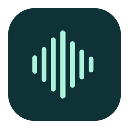
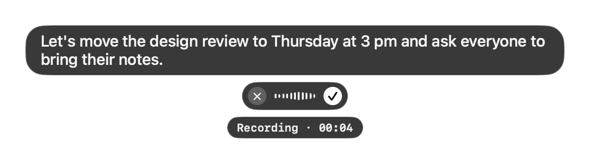
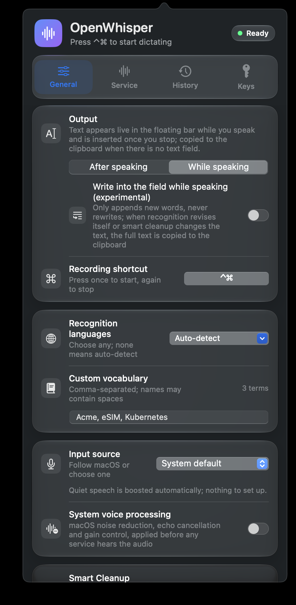

<p align="center">
  
</p>

<h1 align="center">OpenWhisper</h1>

<p align="center">
  <b>Talk instead of typing, in any Mac app.</b><br>
  Press a shortcut, speak, press it again. Your words appear at the cursor, already cleaned up.
</p>

<p align="center">
  
  
  
</p>

<p align="center"><b>English</b> · <a href="README.zh-CN.md">简体中文</a></p>

<p align="center">
  
</p>

OpenWhisper lives in your menu bar. Write an email, reply in Slack, prompt an AI chat, or name a branch in a terminal: put your cursor there, press **⌃ Control + ⌘ Command**, and talk. When you press the shortcut again, the text is pasted exactly where your cursor is.

You bring your own API key from OpenAI, ElevenLabs or Meta Muse. There is no account, no server in between and no tracking. Your voice goes straight from your Mac to the speech service you picked.

## What it does

- **Works where you type.** Native apps, Safari and Chrome, Electron and web apps such as Claude, ChatGPT, Slack and VS Code, and terminals such as iTerm2. The text goes to whatever field holds the cursor when you stop, so you can start talking first and click into the right box while you speak.
- **See your words as you say them.** In *While speaking* mode, a small bubble above the controls shows the transcript live. The finished text is pasted once, cleanly, when you stop.
- **Smart Cleanup.** Optionally, a text model polishes the whole dictation before it is pasted. It fixes misheard words from context, drops filler words and false starts, tidies punctuation, writes numbers and dates the usual way, and turns spoken lists into bullet points. It never adds or summarizes anything, and if it fails you get your original words.
- **Your vocabulary.** Add names, products and jargon so the recognizer spells them right.
- **Many languages.** Pick one or several recognition languages, or let it detect them. The interface is available in English, 简体中文, 繁體中文, 日本語 and 한국어, and follows your Mac's language.
- **Good audio, no fiddling.** Choose any microphone, optionally turn on macOS noise reduction and echo cancellation, and let automatic gain lift quiet speech.
- **Out of the way.** No Dock icon, no window. The microphone is only on while you record.

<p align="center">
  
</p>

## Speech services

You need an API key from at least one of these. Paste it in **Settings → Keys**.

| Service | Models used | Get a key |
| --- | --- | --- |
| **OpenAI** (default) | `gpt-transcribe` after you stop, `gpt-live-transcribe` while you speak | [platform.openai.com](https://platform.openai.com/api-keys) |
| **ElevenLabs** | Scribe v2, Scribe v2 Realtime | [elevenlabs.io](https://elevenlabs.io) |
| **Meta Muse** | Muse Voice Transcribe | Your Meta Muse developer account |

Smart Cleanup is optional and uses its own text model: **DeepSeek Flash** (about 1 s), **OpenAI** (`gpt-6-luna`, shares the OpenAI key) or **Gemini** (`gemini-3.5-flash-lite`). You pay each provider directly for what you use.

## Install

**You need:** a Mac with Apple silicon (M1 or later) running macOS 14 Sonoma or later.

### One-line install (recommended)

Open **Terminal** (in Applications → Utilities), paste this line and press Return:

```bash
curl -fsSL https://raw.githubusercontent.com/AlanShaw-GitHub/OpenWhisper/main/script/install.sh | bash
```

It downloads the latest release, checks it against its published SHA-256 checksum, puts **OpenWhisper** in your Applications folder and opens it. You don't need Xcode, and macOS shows no security warning. Run the same line again any time to update.

<details>
<summary>Why no warning, and what the script does</summary>

OpenWhisper is not notarized by Apple, because that requires a paid Apple developer membership. macOS only stops unnotarized apps that carry the "downloaded from the internet" flag, which browsers add and `curl` does not. The [install script](script/install.sh) is about 60 lines: it checks that your Mac has Apple silicon and macOS 14 or later, downloads `OpenWhisper.zip` from this repository's latest release, verifies the checksum and the app's signature, quits a running copy, and copies the app into `/Applications` (or `~/Applications`). Read it before running it if you like.
</details>

### Manual download

Download **OpenWhisper.zip** from [Releases](https://github.com/AlanShaw-GitHub/OpenWhisper/releases/latest), unzip it and drag **OpenWhisper** into Applications. Because the file came through your browser, macOS blocks the first launch with a message that it could not verify the app. Allow it once:

1. Open OpenWhisper and dismiss the message.
2. Go to **System Settings → Privacy & Security**, scroll down, and click **Open Anyway** next to OpenWhisper.
3. Confirm with your password. From then on it opens normally.

### Build from source

Building takes about a minute and needs Xcode 16 or later (free on the Mac App Store; the Command Line Tools with Swift 6 also work).

```bash
git clone https://github.com/AlanShaw-GitHub/OpenWhisper.git
cd OpenWhisper
./script/build_and_run.sh --install
```

This builds `OpenWhisper.app`, copies it to `/Applications` (or `~/Applications` if you can't write to `/Applications`) and opens it. To try it without installing, run `./script/build_and_run.sh`, which builds into `dist/` and launches from there. Apps you build yourself are not quarantined, so there is no Gatekeeper prompt.

### First launch

1. Click the waveform icon in the menu bar.
2. Allow the two permissions the panel asks for:
   - **Microphone**, to hear you.
   - **Accessibility**, in System Settings → Privacy & Security → Accessibility. This lets OpenWhisper see whether the cursor is in a text field and press ⌘V for you.
3. Open **Keys** and paste your API key.
4. Click into any text field, press **⌃⌘**, speak, and press **⌃⌘** again.

## Everyday use

| | |
| --- | --- |
| Start or stop dictating | **⌃⌘** (press both keys together), or ✓ in the floating bar |
| Cancel | × in the floating bar |
| Change the shortcut | Settings → General → Recording shortcut. Two or more modifiers, or modifiers plus a key |
| Get an earlier result | Settings → History keeps your last 5 dictations in memory until you quit |

If the cursor isn't in a text field when the text is ready, OpenWhisper copies it to the clipboard and tells you, so nothing is lost. Press ⌘V wherever you like.

**Output modes.** *After speaking* uploads the whole recording when you stop, which is usually the most accurate. *While speaking* streams audio as you talk and shows live text in the floating bar. An experimental switch can also write into the field as you speak. It only ever appends text and never rewrites what is already there.

## Privacy and security

- **Audio** goes only to the speech service you chose, and only while you record. Nothing is recorded in the background.
- **Text** goes to your chosen text model only if Smart Cleanup is on.
- **API keys** stay on your Mac in `~/Library/Application Support/OpenWhisper/api-keys.json`. The folder and file can be read only by your user account, the keys are never logged, and they are only sent to their own provider.
- **No analytics, no telemetry, no update pings.** The app talks only to the APIs listed above.
- **Clipboard.** To paste, OpenWhisper borrows the clipboard for about 1.5 seconds, then puts your previous contents back. It skips the restore if you copied something new in the meantime. The pasted item is marked as transient, so clipboard-history apps ignore it.
- **History** holds the last five transcripts in memory only and is cleared when you quit.
- **Accessibility.** Web-based apps such as Chrome and Electron only expose their text fields to assistive tools that ask. OpenWhisper sends the same standard request as VoiceOver. It reads which element is focused; it never reads your documents or other apps' contents.

The source is short and readable. Text insertion lives in [`Sources/OpenWhisper/TextOutput`](Sources/OpenWhisper/TextOutput), and network requests in [`Sources/OpenWhisper/Transcription`](Sources/OpenWhisper/Transcription).

## Troubleshooting

- **The text went to the clipboard.** The cursor wasn't in an editable field when the text was ready, or it was a password field, which OpenWhisper deliberately skips. Press ⌘V.
- **Nothing happens when I press the shortcut.** Check that Accessibility is enabled for OpenWhisper. Some ⌃⌘ chords belong to macOS (for example ⌃⌘Space opens the emoji picker), so pick another shortcut if they clash.
- **Accessibility looks enabled but nothing is pasted.** Remove OpenWhisper from the Accessibility list in System Settings, then add it back.

## Uninstall

Quit OpenWhisper from Settings → Keys → Quit, then:

```bash
rm -rf /Applications/OpenWhisper.app "$HOME/Library/Application Support/OpenWhisper"
defaults delete com.alan.wisper
tccutil reset Microphone com.alan.wisper
tccutil reset Accessibility com.alan.wisper
```

## For developers

```bash
swift test                                   # unit tests
./script/build_and_run.sh --diagnostics      # build with test hooks and probes
./script/build_and_run.sh --fixture          # accessibility test window used by the diagnostics
./script/package_release.sh                   # dist/OpenWhisper.zip + .sha256 for a GitHub release
```

Sources are grouped by feature under `Sources/OpenWhisper`: `App`, `Audio`, `Transcription`, `TextOutput`, `Settings`, `System`, `Views` and `Diagnostics`. Interface text goes through `L("…")` with translations in `Resources/<language>.lproj`.

Issues and pull requests are welcome.

## License

[MIT](LICENSE) © 2026 Alan Shaw

OpenWhisper is an independent project. It is not affiliated with or endorsed by OpenAI, ElevenLabs, Meta, DeepSeek or Google. Their names are used only to describe the services OpenWhisper can connect to.
