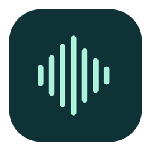
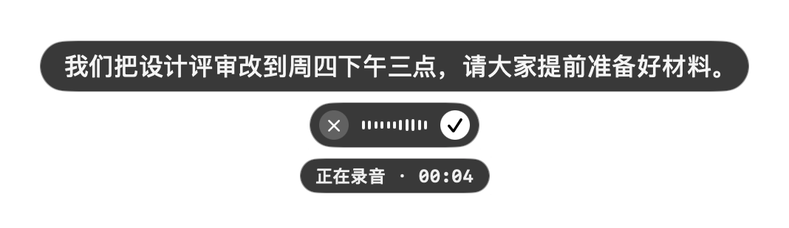
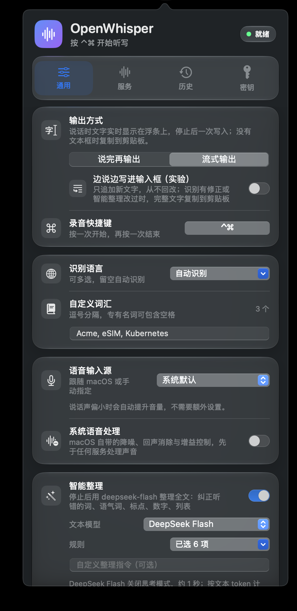

<p align="center">
  
</p>

<h1 align="center">OpenWhisper</h1>

<p align="center">
  <b>在任何 Mac 应用里，用说的代替打字。</b><br>
  按一下快捷键，开口说话，再按一下，整理好的文字就出现在光标处。
</p>

<p align="center">
  
  
  
</p>

<p align="center"><a href="README.md">English</a> · <b>简体中文</b></p>

<p align="center">
  
</p>

OpenWhisper 待在菜单栏里。写邮件、回 Slack、给 AI 提问、在终端里起个分支名，都一样：把光标放在要写字的地方，按 **⌃ Control + ⌘ Command**，然后说话。再按一次快捷键，文字就粘贴到光标所在的位置。

API key 用你自己的，OpenAI、ElevenLabs、Meta Muse 任选其一。不用注册账号，中间没有服务器，也不收集任何数据。你的声音从你的 Mac 直接发给你选的语音服务。

## 它能做什么

- **哪里能打字，哪里就能用。** 原生应用、Safari 和 Chrome、Claude / ChatGPT / Slack / VS Code 这类网页或 Electron 应用，还有 iTerm2 等终端都可以。文字会去到你停止录音那一刻光标所在的输入框，所以可以先开口，边说边点到要写的地方。
- **边说边看到文字。** 选「流式输出」时，浮条上方的气泡实时显示识别到的内容；停止后，完整的文字一次粘贴进去。
- **智能整理。** 可以让文本模型在粘贴前把整段话润色一遍：根据上下文纠正听错的词，去掉「嗯、那个」和说一半的重复，整理标点，把数字和日期写成习惯格式，把口述的列表变成分行要点。它不会添加或总结任何内容；整理失败时保留你的原话。
- **认得你的专有名词。** 把人名、产品名、术语填进自定义词汇，识别时会按你写的拼法。
- **多种语言。** 可以指定一种或几种识别语言，也可以自动识别。界面支持 English、简体中文、繁體中文、日本語、한국어，默认跟随系统语言。
- **声音好，不用调。** 可以选任意麦克风，可以打开 macOS 自带的降噪和回声消除，说话声音小时会自动提升音量。
- **不打扰。** 没有 Dock 图标，没有窗口。只有录音时才会打开麦克风。

<p align="center">
  
</p>

## 语音服务

至少需要下面其中一家的 API key，填在「设置 → 密钥」里。

| 服务 | 使用的模型 | 申请 key |
| --- | --- | --- |
| **OpenAI**（默认） | 说完后用 `gpt-transcribe`，边说边转用 `gpt-live-transcribe` | [platform.openai.com](https://platform.openai.com/api-keys) |
| **ElevenLabs** | Scribe v2、Scribe v2 Realtime | [elevenlabs.io](https://elevenlabs.io) |
| **Meta Muse** | Muse Voice Transcribe | 你的 Meta Muse 开发者账号 |

智能整理是可选的，使用单独的文本模型：**DeepSeek Flash**（约 1 秒）、**OpenAI**（`gpt-6-luna`，与语音服务共用 OpenAI key）或 **Gemini**（`gemini-3.5-flash-lite`）。费用按用量由各家直接向你收取。

## 安装

**需要：** Apple 芯片（M1 或更新）的 Mac，系统为 macOS 14 Sonoma 或更新版本。

### 一行命令安装（推荐）

打开 **终端**（在「应用程序 → 实用工具」里），粘贴下面这行，按回车：

```bash
curl -fsSL https://raw.githubusercontent.com/AlanShaw-GitHub/OpenWhisper/main/script/install.sh | bash
```

它会下载最新版本，核对官方发布的 SHA-256 校验值，把 **OpenWhisper** 放进「应用程序」文件夹并打开。不需要 Xcode，macOS 也不会弹出安全警告。以后想升级，再运行一次同一行命令即可。

<details>
<summary>为什么没有警告，脚本做了什么</summary>

OpenWhisper 没有经过 Apple 公证，因为公证需要付费的 Apple 开发者会员。macOS 只拦截带有「从互联网下载」标记的未公证应用，这个标记是浏览器加上的，`curl` 不会加。[安装脚本](script/install.sh)大约 60 行：检查你的 Mac 是否为 Apple 芯片、系统是否为 macOS 14 以上，从本仓库最新的 Release 下载 `OpenWhisper.zip`，核对校验值和应用签名，退出正在运行的旧版本，再把应用复制到 `/Applications`（或 `~/Applications`）。如果不放心，可以先读一遍再运行。
</details>

### 手动下载

在 [Releases](https://github.com/AlanShaw-GitHub/OpenWhisper/releases/latest) 下载 **OpenWhisper.zip**，解压后把 **OpenWhisper** 拖进「应用程序」。因为文件是经浏览器下载的，第一次打开时 macOS 会拦下来，提示无法验证这个应用。放行一次即可：

1. 打开 OpenWhisper，关掉提示框。
2. 打开 **系统设置 → 隐私与安全性**，拉到下方，点 OpenWhisper 旁边的 **仍要打开**。
3. 输入密码确认。之后就能正常打开了。

### 从源码构建

构建大约一分钟，需要 Xcode 16 或更新版本（Mac App Store 免费下载；装有 Swift 6 的命令行工具也可以）。

```bash
git clone https://github.com/AlanShaw-GitHub/OpenWhisper.git
cd OpenWhisper
./script/build_and_run.sh --install
```

这条命令会构建 `OpenWhisper.app`，复制到「应用程序」文件夹（没有写入权限时放到 `~/Applications`），然后打开它。只想试用、不安装的话，运行 `./script/build_and_run.sh`，它会构建到 `dist/` 并直接启动。自己构建的应用不会被 macOS 隔离，所以不会出现安全提示。

### 第一次打开

1. 点击菜单栏里的波形图标。
2. 按面板提示开启两项权限：
   - **麦克风**：用来听你说话。
   - **辅助功能**：在「系统设置 → 隐私与安全性 → 辅助功能」里开启。OpenWhisper 靠它判断光标是否在输入框里，并替你按下 ⌘V。
3. 打开「密钥」页，粘贴你的 API key。
4. 点进任意输入框，按 **⌃⌘**，说话，再按一次 **⌃⌘**。

## 日常使用

| | |
| --- | --- |
| 开始或停止听写 | **⌃⌘**（两个键同时按下），或点浮条上的 ✓ |
| 取消 | 点浮条上的 × |
| 更换快捷键 | 设置 → 通用 → 录音快捷键。可以只用两个以上的修饰键，也可以是修饰键加一个字母 |
| 找回之前的结果 | 设置 → 历史，保留最近 5 条，只存在内存里，退出即清除 |

如果文字准备好时光标不在输入框里，OpenWhisper 会把它复制到剪贴板并提示你，不会丢失。在任意位置按 ⌘V 即可。

**两种输出方式。** 「说完再输出」在停止后上传整段录音，通常最准确；「流式输出」边说边把声音传给服务，浮条上实时显示文字。流式模式还有一个实验开关，可以边说边写进输入框：只会追加新文字，从不改写已经写进去的内容。

## 隐私与安全

- **声音**只发给你选的语音服务，而且只在录音时发送。不会在后台录音。
- **文字**只有在开启智能整理时，才会发给你选的文本模型。
- **API key** 只保存在你的 Mac 上：`~/Library/Application Support/OpenWhisper/api-keys.json`，文件夹和文件只有你的用户账户能读。key 不会写进日志，只会发给对应的服务。
- **没有统计、没有遥测、不联网检查更新。** 除了上面列出的这些服务，应用不连接任何地方。
- **剪贴板**：粘贴时借用剪贴板约 1.5 秒，然后放回你原来的内容；如果这期间你复制了新东西，就保留你复制的。粘贴的内容带有「临时」标记，剪贴板历史类应用不会记录它。
- **历史**只在内存里保留最近 5 条，退出即清除。
- **辅助功能**：Chrome、Electron 这类网页内核应用，只会向主动询问的辅助工具报告输入框。OpenWhisper 发出的是和 VoiceOver 相同的标准请求，只读取当前焦点是哪个元素，不读取你的文档或其他应用的内容。

源码不长，容易读。文字写入在 [`Sources/OpenWhisper/TextOutput`](Sources/OpenWhisper/TextOutput)，网络请求在 [`Sources/OpenWhisper/Transcription`](Sources/OpenWhisper/Transcription)。

## 常见问题

- **文字被复制到了剪贴板。** 文字准备好时光标不在可编辑的输入框里，或者在密码框里（OpenWhisper 不会往密码框里写字）。按 ⌘V 粘贴即可。
- **按快捷键没有反应。** 检查是否给 OpenWhisper 开了辅助功能权限。有些 ⌃⌘ 组合键是 macOS 自己的（比如 ⌃⌘空格 会打开表情面板），冲突时可以换一个快捷键。
- **辅助功能看起来已开启，但文字没有粘贴进去。** 在系统设置的辅助功能列表里把 OpenWhisper 删掉，再重新添加。

## 卸载

在「设置 → 密钥」页点「退出 OpenWhisper」，然后运行：

```bash
rm -rf /Applications/OpenWhisper.app "$HOME/Library/Application Support/OpenWhisper"
defaults delete com.alan.wisper
tccutil reset Microphone com.alan.wisper
tccutil reset Accessibility com.alan.wisper
```

## 开发

```bash
swift test                                   # 单元测试
./script/build_and_run.sh --diagnostics      # 带测试入口和探针的诊断构建
./script/build_and_run.sh --fixture          # 诊断测试用的辅助功能测试窗口
./script/package_release.sh                   # 生成发布用的 dist/OpenWhisper.zip 和校验文件
```

源码按功能分在 `Sources/OpenWhisper` 下：`App`、`Audio`、`Transcription`、`TextOutput`、`Settings`、`System`、`Views`、`Diagnostics`。界面文字统一经过 `L("…")`，译文在 `Resources/<语言>.lproj`。

欢迎提 Issue 和 Pull Request。

## 协议

[MIT](LICENSE) © 2026 Alan Shaw

OpenWhisper 是独立项目，与 OpenAI、ElevenLabs、Meta、DeepSeek、Google 没有任何关联，也未获得它们的背书。文中提到这些名称，只是为了说明 OpenWhisper 能连接哪些服务。
